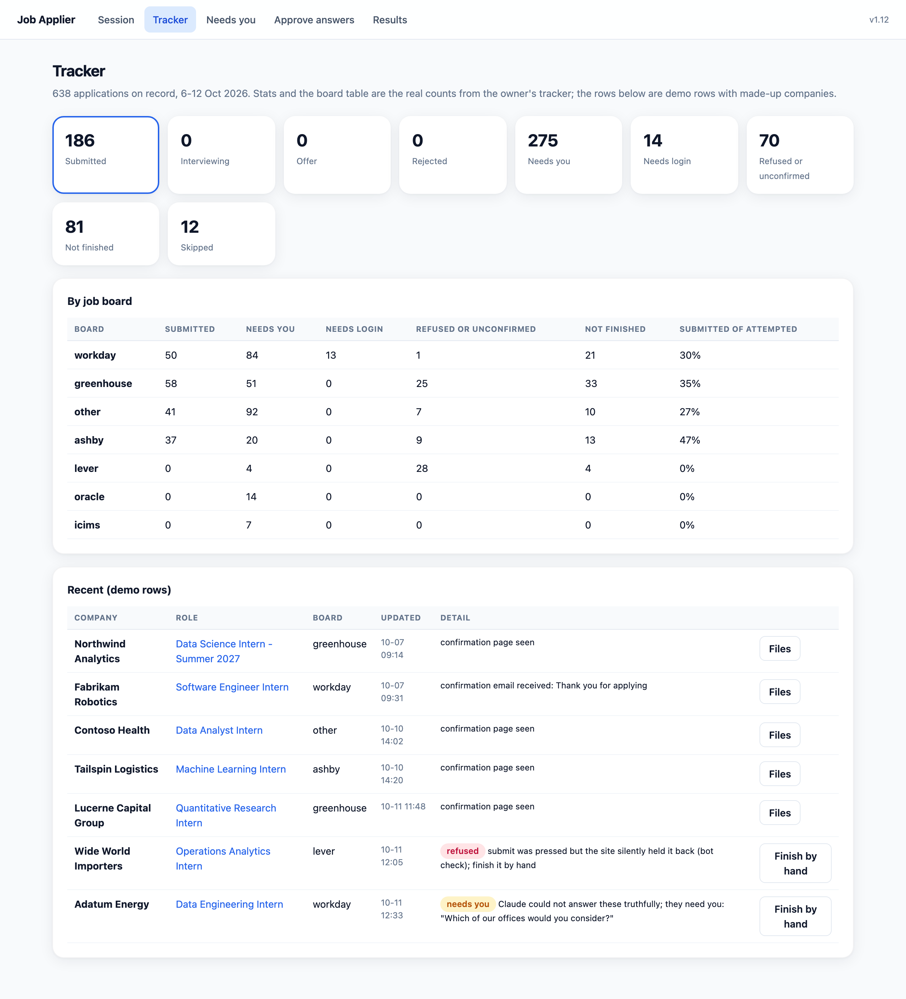
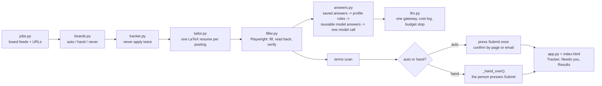

# Job Applier (showcase)

Job Applier finds open roles on public hiring systems, tailors one LaTeX resume per posting, fills the
application in a real Chrome window, verifies what it filled, and either submits or hands the Submit button to
the person. It calls a model only when a rule or a saved answer cannot settle a question, and it reads each
site's terms first: where automation is not allowed, the person presses Submit. This repository is the public
face of a private codebase: the policy, the architecture, the numbers from one week of real use, and one code
excerpt; the source stays private because it ships with the owner's profile, answers and tracker.

Stack: Python 3.13, Playwright, Claude API, Next.js, Postgres (SQLite in the Mac app, Neon Postgres in the cloud
version), FastAPI for the local app, tectonic for LaTeX.



*The Tracker page. The stat tiles and the by-board table are the real counts from the owner's tracker for 6-12
Oct 2026; the rows are demo rows with made-up companies, rendered from `assets/demo_tracker.html` by
`scripts/screenshot.py`.*

## How it decides

The policy lives in one module, `applier/boards.py`, and comes from reading each platform's own published terms
(the research is in [docs/platform-policy.md](docs/platform-policy.md), quotes and sources included). Three
modes:

| Mode | Hiring systems | Why | What the app does |
|---|---|---|---|
| **auto** | Greenhouse, Workday, SmartRecruiters, Workable | The vendor's terms do not address candidate-side automation on the employer's apply page, and no bot check stands at the Submit button | Fill, read back, verify, press Submit once. A visible CAPTCHA, a bot wall or a silent hold-back sets the job aside as `blocked_by_site`; it is never retried with tricks |
| **hand** | Lever, Ashby, iCIMS, Oracle Recruiting/Taleo, SAP SuccessFactors | A CAPTCHA at every submit (Lever hCaptcha, Ashby reCAPTCHA Enterprise) is the site saying no; iCIMS tells employers that candidate-side headless automation breaches their contract; Oracle and SAP forms are not supported by the fill engine, so they are never submitted by the app | Fill and verify everything, then the person presses Submit in that window (`_hand_over()`); in the cloud only a Workday draft can be handed over, anything else is set aside for the person's own machine |
| **never** | LinkedIn, Indeed, Glassdoor, ZipRecruiter, Dice | The board's own user agreement forbids bots, plugins or applying by automated means | Not applied to, not read, not used for discovery |

**The hand-off rule, plainly:** where a site forbids automation, the app does not submit. It fills the form,
verifies it, and hands the Submit button to the person. The same rule applies per employer: before any Submit,
the consent and certification wording on the form is scanned (`terms_forbid_automation`, excerpt below), and a
sentence forbidding automated or third-party submission turns that one job into a hand submit even on a system
that is otherwise `auto`. If a form asks whether an AI tool was used, the answer is yes.

## Architecture

Full diagram and the decision path for one application: [docs/architecture.md](docs/architecture.md).
Every box is a real module in the private repo.



## Numbers

One week of the owner's own job search, with the per-site rules above applied: every posting got its own
tailored resume (628 of 638), every Submit was pressed at most once, and where a site forbade or blocked
automation the app stopped and handed the job to the person. The figures that describe how it behaved:

- **Confirmed per Submit pressed: 186 of 256 (73%).** The rest were interrupted runs, unconfirmed pages, or
  bot checks the app honoured and never retried.
- **Blocked by the site, never retried: 39.** A bot wall, hCaptcha or silent hold-back ends the attempt.
- **Handed to the person: 275** rows the app would not finish on its own (a question with no true source,
  a rejected required field, a login wall, an emailed code).
- **One tailored resume per posting: 628 of 638.**

The source is the owner's tracker (`applier_tracker.csv`, the spreadsheet copy the app rewrites on every
change), window **2026-10-06 to 2026-10-12** (every row the tracker holds falls in it). The query is
[`scripts/numbers.py`](scripts/numbers.py); the CSV itself is not published because it names the companies the
owner applied to. Output, unedited:

```
rows                         638
distinct companies           253
rows with a tailored resume  628
status counts:
  submitted            186
  manual_needed        140
  needs_human          131
  tailored             81
  blocked_by_site      39
  submit_unconfirmed   31
  needs_password       14
  skipped              12
  ready_to_submit      4
submitted, confirmation seen on the page or by email: 182
submitted, other detail:     4  (3 "already applied" per the site, 1 set by hand)
distinct companies submitted 136
submit button pressed        256  (submitted + submit_unconfirmed + blocked_by_site)
confirmed / pressed          186/256 = 73%
submitted / attempted        186/541 = 34%
submitted by day             10-07: 87, 10-10: 64, 10-11: 35
submitted by hiring system   Greenhouse 58, Workday 50, company careers site 41, Ashby 37
```

What each number means, and what it does not:

- **182 confirmed submissions in three run days (7, 10 and 11 Oct 2026), at 136 companies.** This is the number
  that holds up: each one has a confirmation page or a confirmation email recorded next to it. The 186 includes
  three the site reported as duplicates and one marked by hand.
- **31 `submit_unconfirmed`** are not counted as submitted. 27 of them were runs interrupted after Submit was
  pressed and before a confirmation appeared; 4 saw no confirmation. The app never presses Submit twice, so these
  were settled by hand or by a later confirmation email, not by a retry.
- **39 `blocked_by_site`** are bot checks the app honoured (a silent hold-back after Submit, an hCaptcha, an
  "unusual traffic" page). 28 of the 36 Lever rows ended here, which is why Lever is a hand-submit system now.
- **275 "needs you"** (140 `manual_needed` + 131 `needs_human` + 4 dry-run rows): questions the model would not
  answer without a true source (56), required fields the form rejected (50), emailed codes that did not arrive in
  time (13), pages with no form or a login wall (91), and so on. These are the honest cost of the no-invention
  rule and of career sites that are not application forms.
- **The policy postdates the run.** `boards.py` and the employer-terms scan were committed on 14 Oct 2026, after
  these applications. The 37 Ashby submissions above were automated; under today's policy Ashby is a hand
  submit and they would have been handed over. Numbers from the next run will be the first under the policy.
- **Model cost is not reported.** The per-call cost log starts on 10 Oct, so the largest run day (7 Oct, 87
  submissions) has no spend recorded, and the 12 Oct entries are a batch of tailoring and review calls for queued
  jobs that were never submitted. A cost-per-application figure from this log would be wrong in both directions,
  so there is none here.
- **Response rate is not reported.** The Results page matches inbox replies to companies, but nothing in the
  tracker window had been read back yet, and a response rate three days after submitting is not a number.

## Code excerpt: the employer-terms scanner

From `applier/boards.py`, unchanged except for this comment. It runs over the consent and certification wording
seen on the form, the review page and the final page text, right before Submit.

```python
# A sentence that forbids it: a prohibition, an automation word, and the act of applying or submitting. Questions
# ("Did you use an AI tool?") are not prohibitions, and a certification that the facts are true is not either.
_PROHIBIT = re.compile(r"\b(prohibit\w*|not (be )?(permitted|allowed|authori[sz]ed)|may not|must not|shall not|do not|don'?t|agree not to|"
                       r"will not|not (be )?(use|using|used|submit\w*|prepared|filled|generated|created|completed|written|edited|supplemented)|"
                       r"without (the )?(use of|assistance of)|refrain from|forbid\w*)\b", re.I)
_AUTOMATION = re.compile(r"\b(automat\w*|bots?|scripts?|scrapers?|crawlers?|software|AI tools?|AI|artificial intelligence|third[- ]part(y|ies)|"
                         r"on (my|your|their|someone'?s?) behalf|agents?|extensions?|plug-?ins?)\b", re.I)
_APPLYING = re.compile(r"\b(appl(y|ies|ied|ying|ication|icant)s?|submi(t|ts|tted|tting|ssion)s?)\b", re.I)


def terms_forbid_automation(text: str) -> str | None:
    """The first sentence in `text` that forbids applying or submitting by automated or third-party means, else None."""
    for sentence in re.split(r"(?<=[.!])\s+|\n+", text or ""):
        s = sentence.strip()
        if not s or "?" in s or len(s) > 600:
            continue
        if _PROHIBIT.search(s) and _AUTOMATION.search(s) and _APPLYING.search(s):
            return s[:300]
    return None
```

And the call site in `filler.py`, where a match flips the job to a hand submit and the wording is kept with the
application:

```python
(self.out_dir / "terms.txt").write_text("\n\n".join(self.terms_seen) or "(no consent or certification wording on the form)")
if forbids := boards.terms_forbid_automation("\n".join(self.terms_seen) + "\n" + review + "\n" + page_text):
    self.terms_block = forbids
    self.log(f"TERMS the employer's terms forbid automated submission, so this one is a hand submit: {forbids!r}")
    self.hand_submit = True
```

## What it is not

- **No stealth.** No proxies, no user-agent spoofing, no "look different and retry". The browser is a normal
  Chrome driven by Playwright, one application per company per run, low concurrency.
- **No CAPTCHA solving or bot-check evasion.** A challenge is the site saying no; the job is set aside and the
  person finishes it.
- **Never on sites that forbid it.** LinkedIn, Indeed, Glassdoor, ZipRecruiter and Dice are not opened, for
  applying or for discovery.
- **No invented facts.** The tailored resume may not add experience, skills or numbers the base resume does not
  state (the compiler step checks for new numbers); form answers come from the person's profile, saved answers or
  one model call that must answer `null` when it has no true source. "Was an AI tool used?" is answered yes.
- **No passwords in code or logs.** Keychain on the Mac, envelope encryption in the cloud.

## What is in this repo

```
README.md                  this page
docs/platform-policy.md   the per-platform research behind the policy, with sources
docs/architecture.md       full component diagram and the decision path for one application
scripts/numbers.py         the exact query behind the Numbers section (takes the tracker CSV as an argument)
scripts/screenshot.py      renders the demo tracker page to assets/tracker.png with headless Chromium
assets/demo_tracker.html   the demo page (real aggregate counts, fictional rows)
SCRUB_CHECKLIST.md         what was excluded from the private repo and the grep that proves it
```
