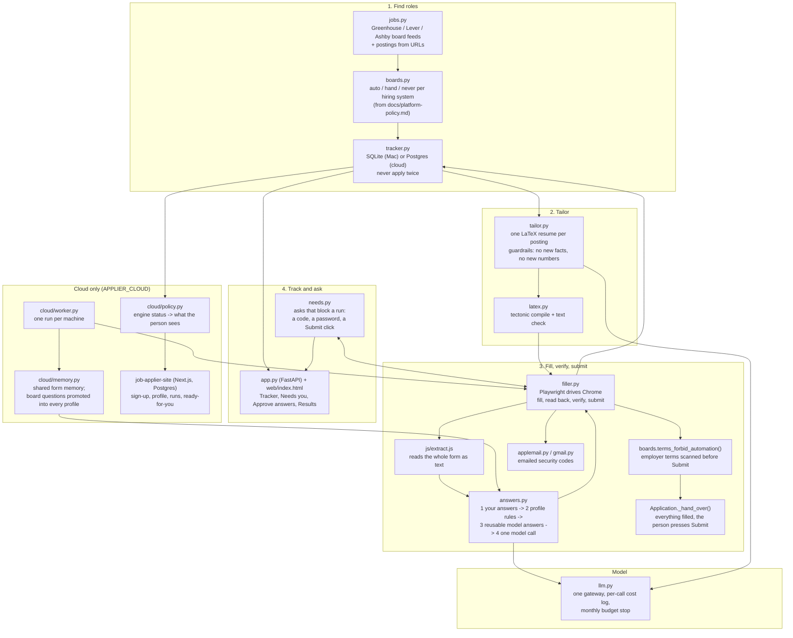

# Architecture

Every box below is a real module in the private repo (`applier/...`); the names are the file names. Two
deployments share the engine: the Mac app (SQLite, Keychain, Chrome on the person's machine) and the cloud worker
(Postgres on Neon, one container per run, Chrome inside the container). The Next.js site is the front door for
the cloud version: sign-up, profile, runs and the "ready for you" list.

## The decision path for one application

1. `boards.forbidden(url)`: a LinkedIn, Indeed, Glassdoor, ZipRecruiter or Dice URL is never opened.
2. `boards.mode(ats)`: Lever, Ashby and iCIMS are `hand`; Greenhouse, Workday, SmartRecruiters and Workable are `auto`.
3. `filler.py` fills every page, reads it back and verifies it. No screenshots are interpreted; the form is read as
   text by `extract.js`.
4. Before Submit, the consent and certification wording seen on the form (saved as `terms.txt` next to the
   application) is run through `boards.terms_forbid_automation()`. One sentence that forbids automated or
   third-party submission turns that job into a hand submit, whatever the vendor allows.
5. `auto`: Submit is pressed once; the page or a confirmation email settles the status (`submitted`). No
   confirmation means `submit_unconfirmed`, and it is never pressed again. A bot check that holds the submission
   back means `blocked_by_site`, and it is never retried with tricks.
6. `hand`: `_hand_over()` leaves the filled form open and posts a Needs-you card; the person presses Submit. In the
   cloud, only Workday keeps a draft under the person's account (`ready_for_you`); everywhere else the job is set
   aside for their own machine.

## Where the model is called

Only through `llm.py`. Answering a form is cheapest-source-first (`answers.py`): the person's own saved answers,
then rules that read the profile (name, links, school, work authorisation, EEO), then model answers marked
reusable, then one call for whatever is left on the page. Tailoring is one call per posting, with the result
checked for invented numbers (`tailor.py`). Every call is appended to `usage.jsonl` with its list-price cost, and
a monthly budget stops sessions.
